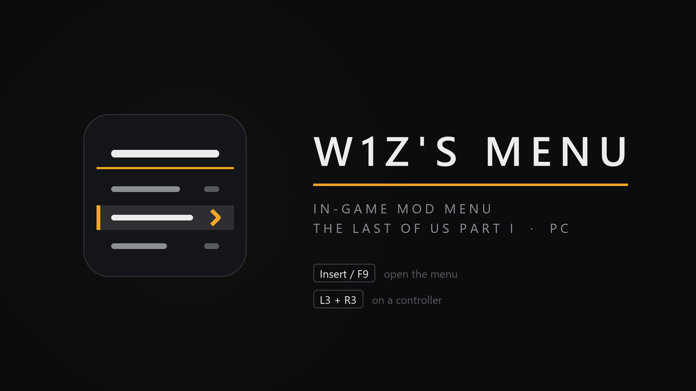

# w1z's menu



**Download:** [GitHub Releases](https://github.com/w1zr/w1z-menu/releases) — get `w1zsMenu-v1.0.0.zip`.

An in-game mod menu for **The Last of Us Part I** (PC). Press **Insert** or
**F9** (controller: **L3 + R3**) to open it. While it is open the game gets no
keyboard, mouse or controller input.

Almost everything in the menu is Naughty Dog's own code: the retail game
still contains the studio's developer menu. w1z's menu finds each
developer-menu item by its exact name when the game starts and uses the
engine's own flag or function, instead of writing to random memory. Anything
it cannot find is greyed out in the menu with the reason, and everything else
keeps working.

## Features

| Page | Options |
|---|---|
| Player | God Mode, No Hit Reactions, Infinite Sprint, Undetectable Player, One Hit Kills |
| Weapons and Items | Infinite Ammo (normal reloads, F7), No Reload (player only, F8), infinity sign on the HUD, Infinite Weapon Health, Disable Weapon Sway, Disable Auto Reload, Disable Auto Holster, Drop All Weapons, Give Joel (9 guns), Give Ellie (3), Give Melee (6), Give Items (throwables, health kits, crafting materials), Infinite Crafting, Infinite Craftables |
| Inventory | Give All + Upgrades, Give Each Craftable, Weapon Parts x10 / x100, Pills x10 / x100, All Recipes, No Recipes |
| Camera | Manual Camera, Teleport Player To Camera, Hide HUD |
| Unlocks | Give / Remove Treasures, Give Journal Pages, Reset Journal, **Unlock Skins** (change outfits in-game from Pause > Skins without finishing the story), All Chapters / Encounters / Extras while the menu is loaded |
| Scene Teleport | Replay Current Scene |
| Misc | Game Speed (experimental) |
| Settings | Remember toggles, notifications, hotkey sound, menu size, feature status page |

Plus **Search** (just start typing) and **Favorites** (Tab / X on any option).

## Controls

| | Keyboard / mouse | Controller |
|---|---|---|
| Open / close | Insert or F9 | L3 + R3 |
| Move | Up / Down, mouse, wheel | D-pad |
| Select | Enter, left click | A / Cross |
| Back | Esc, Backspace, right click | B / Circle |
| Change a number | Left / Right | D-pad left / right |
| Favorite | Tab | X / Square |

## Supported versions

| Game | Version | Status |
|---|---|---|
| Steam, `tlou-i.exe` | 1.1.4.0 / build 18995818 (in-game version 1.1.5) | Tested in-game |
| Steam, `tlou-i-l.exe` | same build | Offline signature tests only |
| Epic Games Store | — | Not tested; features whose code is not found are greyed out instead of patched |

## Install with Fluffy Mod Manager (recommended)

1. Put `w1zsMenu-v1.0.0.zip` in `Fluffy Mod Manager\Games\TLOU\Mods\`.
2. In Fluffy, choose The Last of Us Part I and tick **w1z's menu**.
3. Start the game.

## Install manually

Copy `winmm.dll` and `w1zsMenu.ini` from the zip into the game folder (the
one with `tlou-i.exe`). No other loader is needed: the game loads `winmm.dll`
from its own folder, and the menu forwards every `winmm.dll` function to the
real Windows DLL.

## Uninstall

Untick it in Fluffy, or delete `winmm.dll`, `w1zsMenu.ini`, `w1zsMenu.log`
and `w1zsMenu-README.txt` from the game folder.

## Saves

The menu never writes save or profile files. Giving items, weapons, parts,
treasures or journal pages changes the current game, and the game saves that
at its next checkpoint like any other change. The Chapters / Encounters /
Extras unlocks only last while the menu is loaded.

## Compatibility

- **Other DLL mods:** w1z's menu is `winmm.dll`, so it installs alongside
  `version.dll` and `xinput1_4.dll` mods.
- **TLOU Infinite Ammo** (`version.dll`): if installed, it keeps handling
  ammo and the menu's ammo options are greyed out. The menu already includes
  it, so you can uninstall it.
- **TLOU Outfit Changer** (`xinput1_4.dll`): if installed, it keeps handling
  skins and the menu's skin option is greyed out. The menu includes it too.
- **Fluffy asset mods** (outfits, textures): compatible; the menu changes no
  game files.

## Known issues

- **Encounters magazine size:** in Encounters, a weapon's magazine size can
  change after a restart (e.g. the 9mm going from 6 to 12). This is the game's
  own behaviour: it happens with no mods installed on a verified install, and
  not on story-mode checkpoint restarts.
- **Pause While Open** is shown but greyed out: the engine's pause has not been
  located yet. The game still receives no input while the menu is open.
- **Scene Teleport** only offers Replay Current Scene; jumping to other chapters
  is not in this version.
- **Game Speed** is experimental.
- Steam achievement unlock/clear is intentionally not included (it changes your
  Steam account).

## Settings (`w1zsMenu.ini`)

The menu saves changes automatically. The `[InfiniteAmmo]` section uses the same
keys as the TLOU Infinite Ammo mod; if `w1zsMenu.ini` does not exist yet and
`TLOUInfiniteAmmo.ini` does, its values are imported once.

| Key | Default | Meaning |
|---|---|---|
| `[Menu] MenuKey` / `MenuKey2` | 45 (Insert) / 120 (F9) | Virtual-key codes, 0 = off |
| `[Menu] ControllerToggle` | 1 | L3 + R3 opens the menu |
| `[Menu] RememberToggles` | 1 | Toggles are restored next launch |
| `[Menu] Scale` | 100 | Menu size in percent |
| `[Menu] Notifications` | 1 | On-screen message for hotkey toggles |
| `[InfiniteAmmo] InfiniteAmmo` / `NoReload` / `ShowInfinitySign` | 1 / 0 / 1 | As in TLOU Infinite Ammo |
| `[InfiniteAmmo] ToggleInfiniteAmmoKey` / `ToggleNoReloadKey` | 118 (F7) / 119 (F8) | 0 = no hotkey |
| `[InfiniteAmmo] Logging` | 1 | Write `w1zsMenu.log` |

## Troubleshooting

Open `w1zsMenu.log` next to the game exe. It lists every feature that loaded
and the reason for any that did not. In the menu, **Settings > Feature Status**
shows the same.

| Symptom | Cause / fix |
|---|---|
| No `w1zsMenu.log` | `winmm.dll` is not next to `tlou-i.exe` |
| Insert does nothing | Another program uses the key globally; set `MenuKey` in the ini |
| Give weapon options greyed out | Load into the game first; the weapon list is checked then |
| A feature says "game code changed" | The game was updated; that feature stays off until the menu is updated |

## How it works (for modders)

- **Loader:** `winmm.dll` proxy; every export (same names and ordinals) jumps to
  System32's `winmm.dll`. `tools/gen_winmm_proxy.py` generates the stubs.
- **Overlay:** Dear ImGui on a DirectX 12 Present hook (MinHook) below NVIDIA
  Streamline; the game's direct queue is captured at swapchain creation.
- **Input:** raw input is read and blanked in a `GetRawInputData` hook while the
  menu is open (releases pass through); `ClipCursor` / `SetCursorPos` are held
  back; `XInputGetState` returns an idle pad.
- **Toggles:** each developer-menu bool is found from its item (`lea r8/r9,[flag]`
  before `lea rdx,[label]`), and every read of it is pointed at a private byte
  (the game resets its debug block, so writing the flag does not stick). The
  exact number of reads is part of the signature.
- **Actions:** the developer menu's own callbacks (`callback(item, 5)`) run on
  the game thread from a hook on `GameLoopUpdate`; give-weapon names are checked
  with the engine's weapon lookup first.
- **Ammo** and **skins** reuse the code of the TLOU Infinite Ammo and TLOU Outfit
  Changer mods.

## Building from source

Requirements: Windows, Visual Studio 2022 Build Tools with "Desktop development
with C++". MinHook and Dear ImGui are included in `third_party/`.

```bat
build.bat
build\scan_test.exe "C:\...\The Last of Us Part I\tlou-i.exe" "C:\...\tlou-i-l.exe"
build\proxy_test.exe
package.bat
```

`scan_test` checks every signature, flag read count, callback and hook target
against the real game executables without running the game; `proxy_test`
checks the `winmm.dll` exports and forwarding.

## License

MIT — see [LICENSE](LICENSE). Third-party: MinHook (BSD 2-Clause,
`third_party/minhook/LICENSE.txt`), Dear ImGui (MIT,
`third_party/imgui/LICENSE.txt`). Not affiliated with Naughty Dog or Sony
Interactive Entertainment. This repository contains no game files.
